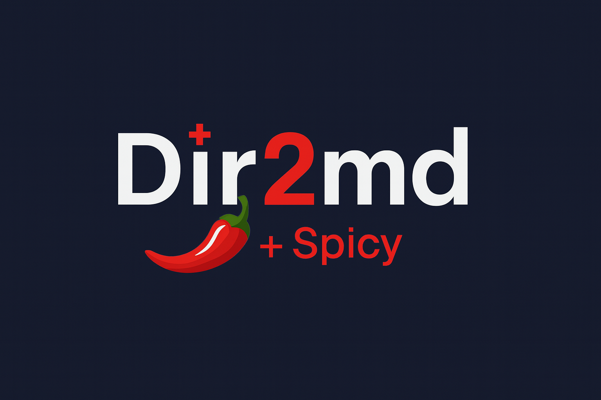

# Dir2md +Spicy

<p align="center">
  
</p>

<p align="center">
  <a href="https://pypi.org/project/dir2md/"></a>
  <a href="https://pypi.org/project/dir2md/"></a>
  <a href="https://opensource.org/licenses/MIT"></a>
  <a href="https://www.python.org/downloads/"></a>
  <a href="https://github.com/flamehaven01/Dir2md/releases"></a>
  <a href=".github/workflows/release.yml"></a>
  <a href="https://github.com/flamehaven01/Dir2md"></a>
  <a href="https://github.com/flamehaven01/Dir2md/issues"></a>
</p>

<p align="center">
  <strong>Transform your codebase into LLM-optimized markdown blueprints</strong>
</p>

Dir2md converts directory structures into AI-friendly markdown with intelligent content sampling, security masking, and token-budget control—perfect for AI-assisted development.

## Quick Start

**New to Dir2md?** Check out **[Wiki.md](docs/Wiki.md)** for a friendly introduction with examples.

## Fresh highlights (1.2.2) - Security Hardening & Compatibility

**v1.2.2 (2026-01-06)** - Boundary-safe symlink handling, large-file masking, and deprecation-free pathspec matching:

### Security & Reliability
- **CRITICAL**: Symlinked directory traversal now blocked when it escapes root
- **CRITICAL**: Large-file masking now chunked (no unmasked bypass)
- **COMPAT**: PathSpec updated to `gitignore` engine to remove deprecation warnings

### Configuration System (unchanged, still 1.2.1)
- **3-Tier Priority**: User CLI > Project config > System defaults
- **`--defaults-file`**: Custom defaults.json path support
- **`pyproject.toml`**: `[tool.dir2md.excludes]` project-level configuration
- **Flexible & Safe**: Graceful fallback on configuration errors

---

### v1.2.0 Features - Intelligence Without Complexity

**Zero-Configuration Intelligence**: All optimizations activate automatically based on your preset choice.

- **Gravitas Compression**: 30-50% token reduction, auto-enabled in `pro`/`ai` presets
- **Smart Query Processing**: 60% → 90% accuracy with typo correction + synonym expansion
- **AST Semantic Sampling**: 30-40% additional reduction for Python files

**Combined Power**: Up to 60-70% total token reduction with zero configuration overhead.

### Try Online
[**Dir2md Demo on Hugging Face Spaces**](https://huggingface.co/spaces/Flamehaven/dir2md-demo) — No installation required

### Installation

```bash
# From PyPI
pip install dir2md

# From GitHub (latest features)
git clone https://github.com/Flamehaven/dir2md.git
cd dir2md
pip install -e .
```

### Basic Usage

```bash
# Generate markdown blueprint (basic, no optimizations)
dir2md .

# Production-ready with auto-optimization (gravitas=basic, query expansion ON)
dir2md . --preset pro --query "authentication"

# AI-optimized with maximum intelligence (gravitas=medium, query expansion ON, AST sampling ON)
dir2md . --ai-mode --query "atuh"  # Typo? No problem - auto-corrected to "auth"
# Auto-activates: Typo correction + Query expansion + Gravitas compression + AST sampling

# Traditional usage still works
dir2md . --preset raw  # Pure original, no optimizations
```

**What's new in v1.2.2?** Root-safe symlink handling, large-file masking, and cleaner pathspec matching.
**What's new in v1.2.1?** Enterprise-grade security fixes + flexible 3-tier configuration system.
**What changed in v1.2.0?** All intelligence is now automatic. Just choose your preset - the system handles the rest.

## Key Features

**Intelligent Optimizations (NEW 1.2.0)** - Zero configuration required
- **Gravitas Compression** — Symbolic compression (30-50% reduction), auto-enabled in `pro`/`ai`
- **Smart Query** — Typo correction + synonym expansion (60%→90% accuracy), auto-enabled with queries
- **AST Sampling** — Python structure extraction (30-40% reduction), auto-enabled for .py files in `pro`/`ai`

**Core Features**
- **Smart Sampling** — Head/tail content sampling with configurable token budgets
- **Security Masking** — Automatic detection of API keys, tokens, credentials, PEM blocks
- **AI Optimization** — Query-based ranking, JSONL output, LLM-friendly formatting
- **Risk Analysis (Spicy)** — Built-in security scanning with 5-level severity findings
- **Flexible Output** — Markdown, JSON, JSONL, and manifest formats
- **Custom Patterns** — Extensible masking via CLI, files, or `pyproject.toml`

### What is Spicy? 🌶️

**Spicy** is Dir2md's built-in security risk analyzer that automatically scans your configuration and codebase for potential issues.

**Enabled by default** — every blueprint includes a Spicy risk report with:
- **5 severity levels**: ⚪️ ok, 🌶 warn, 🌶🌶 risk, 🌶🌶🌶🌶 high, 🌶🌶🌶🌶🌶 critical
- **Risk score** (0-100) and finding counts
- **Actionable suggestions** for each issue

**Common findings:**
- Masking disabled when secrets might be present
- Symlink traversal outside repository
- Missing provenance tracking (no manifest)
- Query provided but no files matched
- Large files that may exceed token budgets

**Control Spicy behavior:**
```bash
# Default: Spicy enabled
dir2md .

# Disable Spicy
dir2md . --no-spicy

# Strict mode: fail build on high/critical findings (CI/CD)
dir2md . --spicy-strict  # exits with code 2 if risks found
```

**Example Spicy output:**
```
## Spicy Review
- Spicy Level: 🌶🌶  score=20/100
- Counts: {'ok': 0, 'warn': 1, 'risk': 0, 'high': 1, 'critical': 0}

| File | Line | Severity | Category | Message | Suggestion |
|------|------|----------|----------|---------|------------|
| - | 0 | high | security | masking is off in non-raw preset | use --masking basic |
| - | 0 | warn | tracking | manifest disabled | enable --emit-manifest |
```

## Configuration

### Presets

| Preset | Token Budget | Best For |
|--------|--------------|----------|
| `raw` | Unlimited | Full code review, development |
| `pro` | User-defined | Production with custom budgets |
| `ai` | 6000 | LLM context with query ranking |
| `fast` | Minimal | Tree structure + manifest only |

### Configuration File

Create `pyproject.toml` in your project root:

```toml
[tool.dir2md]
preset = "pro"
budget_tokens = 8000
include_glob = ["src/**/*.py", "tests/**/*.py"]
exclude_glob = ["**/__pycache__/**"]
emit_manifest = true

# NEW in v1.2.1: Project-level default excludes
excludes = [
    "*.log",
    "temp/",
    "cache/",
    "*.tmp"
]
# Priority: User CLI (--exclude-glob) > Project (excludes) > System (defaults.json)

[tool.dir2md.masking]
level = "basic"
patterns = ["(?i)custom_secret_\\w+"]
```

### Configuration Priority System (v1.2.1)

Dir2md uses a **3-tier priority system** for exclusion patterns:

1. **System Defaults** (lowest priority)
   - Built-in `defaults.json` or custom via `--defaults-file`
   - Contains common patterns: `.git`, `__pycache__`, `node_modules`, etc.

2. **Project Config** (medium priority)
   - `pyproject.toml` `[tool.dir2md]` `excludes = [...]`
   - Project-specific patterns that extend system defaults

3. **User CLI** (highest priority)
   - `--exclude-glob` arguments
   - Override everything for ad-hoc exclusions

**Example:**
```bash
# Use custom system defaults
dir2md . --defaults-file my-defaults.json

# Project config in pyproject.toml adds to system defaults
# [tool.dir2md]
# excludes = ["*.log", "temp/"]

# User CLI takes precedence over all
dir2md . --exclude-glob "secret-data/"
# Final: secret-data/ (user) + *.log,temp/ (project) + .git,__pycache__,... (system)
```

**Learn more:** [CLI Reference](docs/CLI_REFERENCE.md) | [Features](docs/FEATURES.md)

## Common Commands

```bash
# AI/LLM context generation (all optimizations auto-enabled)
dir2md . --ai-mode --query "authentication" --budget-tokens 4000
# Auto: typo correction + expansion + gravitas medium + AST sampling

# Production-ready (balanced optimization)
dir2md . --preset pro --query "auth" --budget-tokens 6000
# Auto: expansion + gravitas basic + AST sampling

# Security audit with masking
dir2md . --masking advanced --spicy-strict

# CI/CD integration (no optimizations, deterministic)
dir2md . --preset raw --emit-manifest --no-timestamp

# Quick preview (tree only, minimal processing)
dir2md . --preset fast --dry-run

# NEW in v1.2.1: Custom configuration
dir2md . --defaults-file my-defaults.json  # Custom system defaults
dir2md . --exclude-glob "secret-data/"     # Ad-hoc user override
# + pyproject.toml [tool.dir2md.excludes] for project-level patterns
```

**Note**: In v1.2.0, all intelligence is automatic - just choose your preset!

**Full reference:** [`dir2md --help`](docs/CLI_REFERENCE.md)

## Docker

```bash
# Build image
docker build -t dir2md:local .

# Run (Windows)
docker run --rm -v %cd%:/work dir2md:local /work --ai-mode

# Run (Linux/macOS)
docker run --rm -v $PWD:/work dir2md:local /work --ai-mode
```

## Contributing

We welcome contributions! See [CONTRIBUTING.md](CONTRIBUTING.md) for guidelines.

### Development Setup

```bash
git clone https://github.com/Flamehaven/dir2md.git
cd dir2md
pip install -e ".[dev]"
python -m pytest -v
```

### Reporting Issues

- **Bugs**: [GitHub Issues](https://github.com/Flamehaven/dir2md/issues)
- **Features**: [GitHub Discussions](https://github.com/Flamehaven/dir2md/discussions)
- **Security**: info@flamehaven.space

## Documentation

- **[CLI Reference](docs/CLI_REFERENCE.md)** — Complete command-line options
- **[Features](docs/FEATURES.md)** — Detailed feature documentation
- **[Troubleshooting](docs/TROUBLESHOOTING.md)** — Common issues and solutions
- **[Usage Examples](USAGE_EXAMPLES.md)** — Quick copy-paste recipes
- **[Contributing](CONTRIBUTING.md)** — Development guidelines

## Quality & Certification

**SIDRCE Certified** — ID: SIDRCE-DIR2MD-20260106-v1.2.2
Grade: **A (90-94/100)** — Security: A+ | Reliability: A | Performance: A | Maintainability: A

**v1.2.2 Improvements:**
- Root-safe symlink traversal when following links
- Large-file masking now chunked (no bypass)
- PathSpec matching moved to gitignore engine (no deprecation warnings)
- Production-ready with enterprise-grade quality

Architecture follows distributed responsibility patterns with comprehensive test coverage and deterministic cross-platform behavior.

## License

MIT License — see [LICENSE](LICENSE) for details.

## Acknowledgments

This project shares its name with [IsaacBreen's dir2md](https://pypi.org/project/dir2md/), a simpler directory-to-markdown tool. Our enhanced version focuses on LLM optimization, token budgeting, and security masking for AI-assisted development.

---

<p align="center">
  Made with care by <strong>Flamehaven</strong> for developers who want their AI to understand their code
</p>
